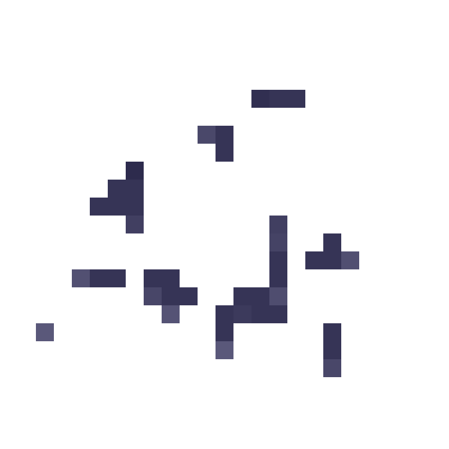
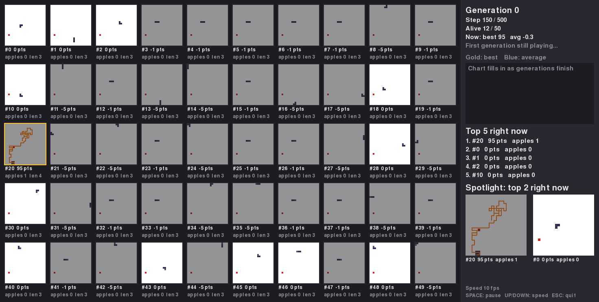
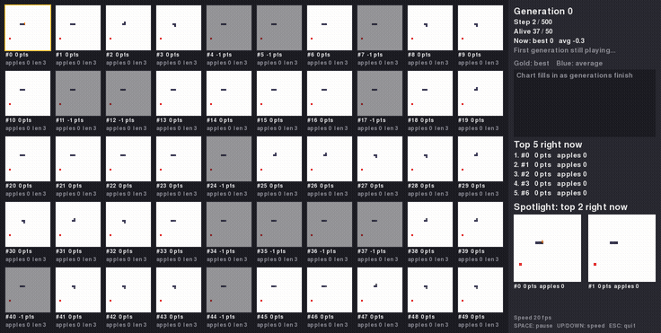

# GA Snake, original version (2019 to 2021)

A genetic algorithm that evolves a population of snakes to play Snake. This is the code as it was first written, kept unchanged so you can see where the project started. On current Python it does not finish a generation. The problems are listed below.

## How it works

- Each snake has a fixed list of 500 moves. Each move is UP, DOWN, LEFT or RIGHT.
- The board is 250 by 250 pixels: 25 by 25 cells of 10 pixels. Each snake starts with length 3.
- Score: +100 for an apple, -5 for hitting a wall, -1 for running into itself. Surviving scores nothing.
- All 50 snakes of a generation play at the same time, in one window, on one board. Their pictures overlap.
- Each new generation: two parents are picked by a tournament of 5, their move lists are combined by uniform crossover (rate 0.5), and each move is changed with probability 0.01.
- Settings: 50 snakes, 500 moves, 100 generations, random seed 9000, 10 frames per second.

## The original window



This is the window the original code draws. Every snake is on the same board, so they overlap, and the apples are the same dark colour as the snakes' heads. The picture was rendered from the first fixed version, which draws the same way.

## Running it

You need Python, `pygame` and `numpy`.

```
python -m venv venv
venv/bin/pip install pygame numpy
venv/bin/python "Main Project/genetic_algorithm.py"
```

On Windows, use `venv\Scripts\pip` and `venv\Scripts\python`.

Classic pygame 2.6.1 has no build for Python 3.14. If pip fails to install it, use `pygame-ce`, which is a drop-in replacement.

On Python 3.14 the first generation stops immediately with a `TypeError` (problem 1 below). Fixing problem 1 exposes problem 2.

## Known problems

| # | Problem | Where | What happens |
|---|---|---|---|
| 1 | `randrange` is given a float, `display_width / 10`. Python 3.12 and later reject floats ([Python docs](https://docs.python.org/3/library/random.html)) | `pysnake.py` lines 97 and 134 | `TypeError` before the first generation finishes |
| 2 | `choose_parent` returns the list from the tournament, not a single snake | `genetic_algorithm.py` line 124 | `AttributeError: 'list' object has no attribute 'crossover'` at the first breeding step |
| 3 | Games read past the end of a snake's move list | `pysnake.py` line 42 | `IndexError` when a snake survives all 500 moves |
| 4 | A snake told to reverse is frozen in place | `pysnake.py`, `generate_snake` | It never crashes. In a test, 200 reverse moves left the snake where it started with 0 points, which avoids the -5 wall penalty |
| 5 | Every snake reseeds Python's random generator with 9000, the same generator the GA uses | `pysnake.py` line 66 | All 50 snakes start with the same apple, and breeding randomness depends on the game |
| 6 | The snake starts facing LEFT with its body to the left of its head | `pysnake.py` line 96 | A LEFT first move runs straight into its own body |
| 7 | Scores are stored at an index that shifts when a snake crashes | `pysnake.py` line 47 | In a test, 20 of the 50 fitness values were attached to the wrong snake |
| 8 | Crossover and mutation insert genes instead of replacing them | `genetic_algorithm.py` lines 44, 46, 53 | Move lists grow past 500 entries, and the extra entries are never used |
| 9 | The first move reads the last gene, so gene 499 is never used | `pysnake.py` line 42 | An off-by-one error in the move index |
| 10 | No elitism | `GeneticAlgorithm.new_generation` | The best snake can be lost between generations |
| 11 | The game runs at 10 frames per second even during evaluation | `play_game`, `clock.tick` | One generation can take about 50 seconds, so 100 generations take a long time |

## Where it went

A later version fixes these problems. It also replaces the fixed move list with a small neural network, and it shows every snake on its own board. Over five seeds of 100 generations each, a fixed-list version with the same fixes averaged a best score of 382 points (±52), and the neural network averaged 1,929 points (±886). The best single game scored 2,709 points, about 27 apples.





The later version is in a private repository for now.

## Repository layout

- `Main Project/genetic_algorithm.py`: the population, selection, crossover, mutation and the main loop
- `Main Project/pysnake.py`: the board, the moves, the scoring and the drawing
- `Main Project/__init__.py`: empty
- `.vscode/settings.json`: points VS Code at a Windows virtual environment

## History

`pysnake.py` was written in 2019 and `genetic_algorithm.py` in 2021, for Windows with Python 3.8 and pygame 1.9.6. This repository starts from that version.
